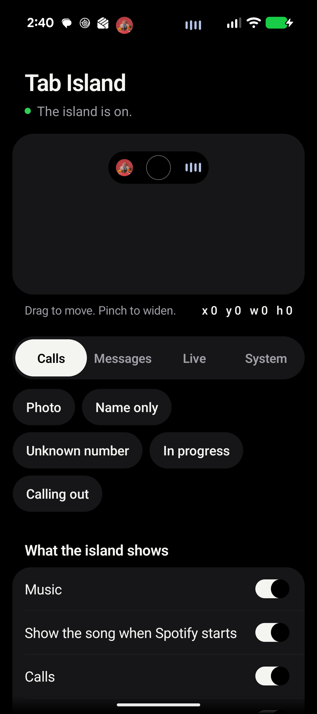
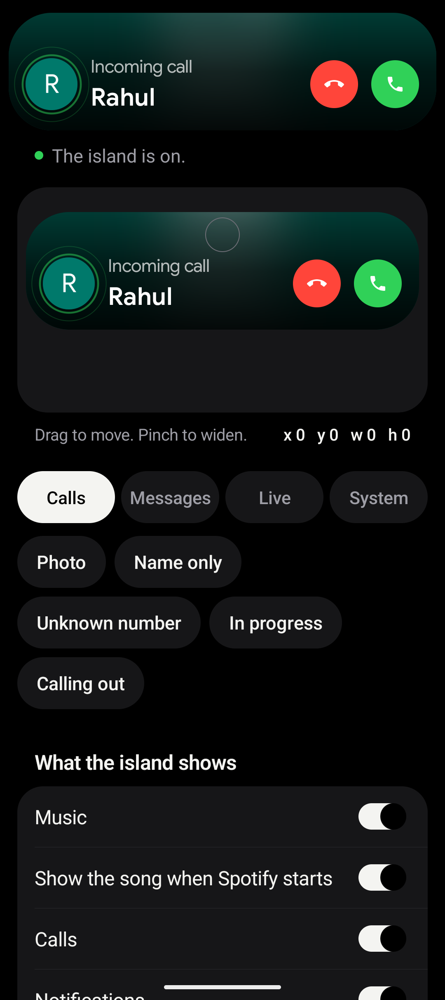
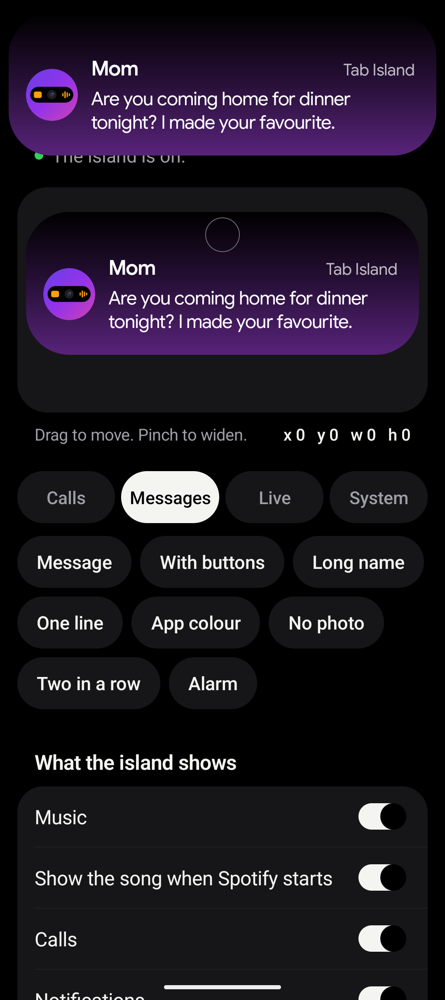

# Tab Island

A Dynamic Island–style overlay for Android. Tab Island draws a black pill around the front camera that shows music, calls, messages, timers, navigation, downloads and system events, and it can replace the system's heads-up pop-ups.

It is measured from the phone's real camera cutout and moves with spring physics, so it sits on the hole instead of floating near it.

<p>
  
  
  
</p>

## Features

- **Calls:** incoming, outgoing and in-progress, with answer and decline buttons.
- **Messages:** expand into a card with reply actions. New ones queue instead of replacing each other.
- **Live activity:** music with controls, timers, navigation, downloads and the flashlight.
- **System:** charging, low battery and ringer changes.
- A settings screen that previews every style on demand, turns each feature on or off, and lets you drag and pinch the island to fit your camera.

## Requirements

- Android 12 (API 31) or newer
- A phone with a centred hole-punch camera works best. It was built and tested on a Pixel 9a.

## Build

```sh
./gradlew assembleDebug   # APK lands in app/build/outputs/apk/debug/
./gradlew installDebug    # or install straight to a connected phone
./gradlew test            # unit tests
```

The app has no dependencies beyond the Android SDK. It is plain Kotlin with Android Views, with no XML layouts, Compose or Material library.

## Setup

Open Tab Island and follow its three steps:

1. **Accessibility:** turn on Tab Island so it can draw the island.
2. **Notification access:** lets it see music, calls and notifications.
3. **Replace system pop-ups (optional):** run this once from a computer:
   ```sh
   adb shell pm grant com.tabisland android.permission.WRITE_SECURE_SETTINGS
   ```
   To get the system pop-ups back:
   ```sh
   adb shell settings put global heads_up_notifications_enabled 1
   ```

Don't force-stop the app. Android switches off its accessibility service when you do, and you'll have to turn on step 1 again.

## Privacy

Tab Island reads your notifications so it can show them on the island. It has no internet permission, so nothing it reads leaves the phone.

## Project docs

- [PRODUCT.md](PRODUCT.md): what the app is for and its principles
- [design.md](design.md): the design system (colours, type, motion)

## License

[MIT](LICENSE). The demo caller photo (`app/src/main/res/drawable-nodpi/demo_caller.jpg`) is a stock image under the [Unsplash License](https://unsplash.com/license), not MIT.

"Dynamic Island" is a trademark of Apple Inc. This project is not affiliated with Apple.
